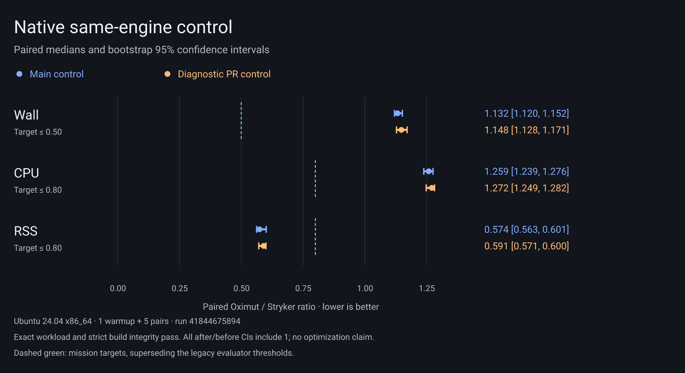

# Native same-engine control: run 41844675894

[Full native run](https://github.com/RuiCostafrg/oximut/actions/runs/41844675894). One warmup and five measured pairs; correctness and strict build integrity pass (41 sources, 102 tests, five mutated files, ten exact killed edits). This PR changes no engine behavior; control ratios establish no attributable product speedup. The committed original summary, measurement rows and metadata retain the control evidence. Full prepared projects, binaries and logs are available only in the workflow artifact during its configured 14-day retention window; hashes cannot recover those omitted files after expiry.



The PNG and SVG are rendered with Vega 6.4.0 and resvg-wasm 2.6.2 from the
original summary; the script never recalculates or alters the paired intervals.
Regenerate in this directory:

```sh
npm install --prefix /tmp/oximut-chart-render --ignore-scripts vega@6.4.0 @resvg/resvg-wasm@2.6.2
NODE_PATH=/tmp/oximut-chart-render/node_modules node plot.mjs
```

The renderer uses installed DejaVu Sans or Roboto. For another TrueType font,
set `CHART_FONT` to its path and `CHART_FONT_FAMILY` to its family name.
`SHA256SUMS` covers the retained originals, script, Vega specification and figures.

Raw medians (decimal MB; CPU total/user/sys computed independently):

| Candidate / tool | Wall s | CPU s (user / sys) | Aggregate peak RSS MB | Peak / observed processes |
|---|---:|---:|---:|---:|
| before / oximut | 5.5096 | 8.1521 (5.5404 / 2.6351) | 328.09 | 4 / 21 |
| before / stryker | 4.8445 | 6.4169 (5.7124 / 0.6984) | 570.48 | 3 / 3 |
| before / vitest | 1.3687 | 1.7582 (1.4380 / 0.3063) | 280.33 | 2 / 5 |
| after / oximut | 5.5213 | 8.1416 (5.5585 / 2.5990) | 335.18 | 4 / 21 |
| after / stryker | 4.8271 | 6.4565 (5.7668 / 0.6739) | 569.69 | 3 / 3 |
| after / vitest | 1.3732 | 1.7526 (1.4388 / 0.3154) | 276.50 | 2 / 5 |

Paired median ratios [bootstrap 95% CI]:

| Comparison | Wall | CPU | RSS |
|---|---:|---:|---:|
| after_vs_before | 1.0064 [0.9982, 1.0099] | 1.0065 [0.9826, 1.0163] | 1.0193 [0.9558, 1.0579] |
| after_vs_stryker | 1.1485 [1.1283, 1.1713] | 1.2715 [1.2487, 1.2824] | 0.5906 [0.5711, 0.6003] |
| before_vs_stryker | 1.1325 [1.1203, 1.1522] | 1.2590 [1.2389, 1.2764] | 0.5742 [0.5625, 0.6012] |

Mission targets are CI upper bounds of wall <= 0.50, CPU <= 0.80 and RSS <= 0.80, superseding the legacy evaluator thresholds retained in the original summary.

`resources.phaseWallMs` medians (ms):

| Phase | Before | After |
|---|---:|---:|
| finalInputValidation | 0.000231 | 0.000240 |
| inputAndSchedulerPreparation | 3.621491 | 3.630679 |
| instrumentedBaseline | 1041.439303 | 1055.686266 |
| mutationExecution | 2924.742321 | 2942.091534 |
| mutationPlanning | 0.077957 | 0.089598 |
| originalBaseline | 1476.634713 | 1449.531720 |
| postBaselineValidation | 0.000160 | 0.000181 |
| teardown | 49.427232 | 60.121201 |

Against the mission targets, wall and CPU are missed; RSS is met. The overall goal remains unmet.
