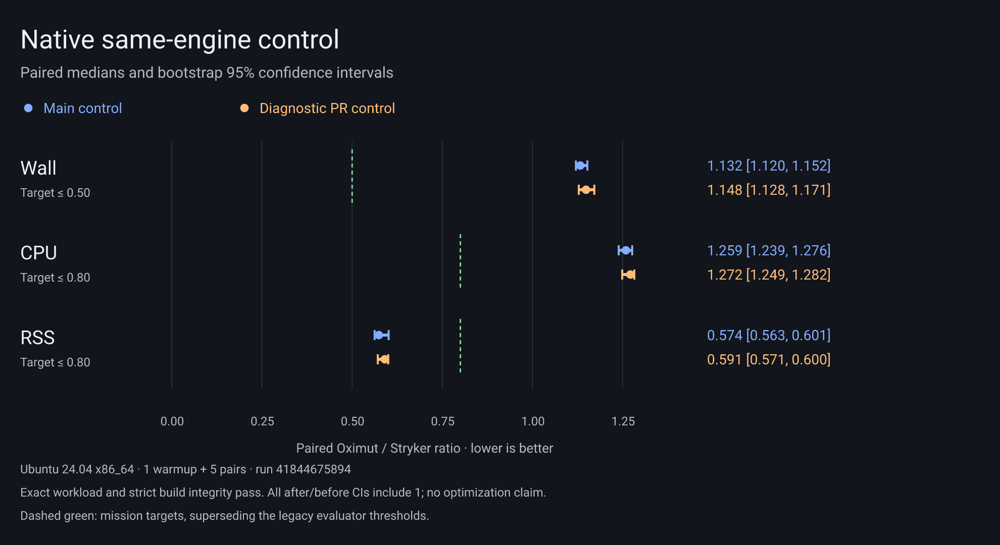

# Performance workstream: measure the isolation boundary

Status: diagnostic capture complete; optimization experiments pending. No
performance improvement or release claim.
Starting point: main `d8e0c512eae792d522d3bf47bfa50ee3a9ce5cbc`.
The native comparison workflow now pins this revision as `BEFORE_COMMIT` for
subsequent experiments, replacing the pre-coordinator baseline. This diagnostic
PR changes no product execution code; any same-engine before/after timings are
control evidence, not an optimization attributable to the capture tooling.

## Rechecked native evidence

Downloaded both complete artifacts into new empty directories and read their
summaries, raw rows, build-integrity gates and phase evidence. The extracted
[evidence capsule](../benchmarks/results/2026-11-04-edgy-baseline/evidence.json)
retains all measurement rows' resource fields, phases, ratios, gates and SHA-256
hashes of the original summary/measurement files. Full artifacts are available at
[run 41340467516](https://github.com/RuiCostafrg/oximut/actions/runs/41340467516)
and [run 41797866089](https://github.com/RuiCostafrg/oximut/actions/runs/41797866089).
Their workflow retention is 14 days; the committed extract persists after expiry,
but its hashes cannot reconstruct the omitted projects, binary and logs.
Each campaign has one warmup and five measured pairs on native Ubuntu x86_64.

Raw medians (decimal MB; CPU total and user/sys are independently computed medians):

| Campaign / tool | Wall s | CPU s (user / sys) | Peak aggregate RSS MB | Peak processes / observed identities |
|---|---:|---:|---:|---:|
| 41340467516 Oximut forks | 4.5948 | 6.3936 (4.9673 / 1.4643) | 341.57 | 4 / 21 |
| same campaign Stryker | 4.1552 | 5.7526 (5.2354 / 0.5136) | 571.47 | 3 / 3 |
| same campaign plain Vitest | 1.1984 | 1.5647 (1.3345 / 0.2301) | 275.28 | 2 / 5 |
| 41797866089 Oximut threads | 4.7381 | 6.7565 (5.2480 / 1.5169) | 286.44 | 3 / 3 |
| same campaign Stryker | 4.6247 | 6.1208 (5.4524 / 0.6398) | 571.18 | 3 / 3 |
| same campaign plain Vitest | 1.2922 | 1.6505 (1.3733 / 0.2637) | 279.20 | 2 / 5 |

Paired median Oximut/Stryker ratios [bootstrap 95% CI]:

| Candidate | Wall | CPU | RSS |
|---|---:|---:|---:|
| Native coordinator / forks | 1.1065 [1.0822, 1.1096] | 1.1239 [1.0922, 1.1295] | 0.5945 [0.5780, 0.6186] |
| Opt-in threads | 1.0196 [1.0138, 1.0891] | 1.1039 [1.0998, 1.1549] | 0.5062 [0.4801, 0.5269] |
| Required CI upper bound | 0.50 | 0.80 | 0.80 |

Both correctness and strict build-integrity gates pass: all 41 source files,
102 tests, five mutation sources, ten exact arithmetic edits, all killed.
Only the RSS target is met. The harness still encodes the older wall/RSS
thresholds; it must be aligned with all three mission targets before claiming
success. These two runs do not form a paired thread/fork experiment against
each other; their before candidates also differ. Do not subtract their raw
medians to attribute a thread improvement.

Median `resources.phaseWallMs` (ms):

| Phase | Forks | Threads |
|---|---:|---:|
| inputAndSchedulerPreparation | 2.2727 | 3.5077 |
| originalBaseline | 1232.3603 | 1347.2373 |
| instrumentedBaseline | 871.1838 | 882.6543 |
| postBaselineValidation | 0.0004 | 0.0003 |
| mutationPlanning | 0.0774 | 0.0785 |
| mutationExecution | 2437.3372 | 2454.5349 |
| teardown | 51.6962 | 50.3735 |
| finalInputValidation | 0.0003 | 0.0001 |

The later [native same-engine control](../benchmarks/results/2026-11-04-native-control/README.md)
(run 41844675894) also passes the exact workload and strict build-integrity gates.
All after/before confidence intervals include 1; this diagnostic PR changes no
engine behavior and establishes no attributable performance improvement. The
capsule retains every resource metric, phase timing, paired interval, original
summary/measurement row and a reproducible PNG/SVG chart.

## Source audit and completed diagnostic

The mutation phase costs about 244–245 ms per mutant in both runs. That measures
the entire job, including adapter, worker and coordinator work. It does not
establish a fixed Vitest orchestration cost independent of worker startup.
Vitest 4.1.12's `runTestSpecifications` calls `runFiles`, which creates the pool
only once. Its isolated pool still creates and stops a runner per test file.
A source audit found no mandatory debounce/sleep in this path. Repeating one
spec ten times in a single call would still create ten isolated workers and
would also require new result/selector/deadline attribution. Batching alone
therefore has no established large saving.

The earlier single 50 ms startup checkpoint could not explain a complete mutant
job. The completed diagnostic captures the controller's first mutant from
incoming request through reply, including fork creation, started/run messages,
collection RPC, completion,
stop and exit, and retains an inspector CPU profile of that controller job.
CPU consumed by the controller process is not tree CPU; worker boundaries include
worker startup and RPC wait, not an exact CPU partition. Raw qualification
resources from this profiled run are overhead-bearing diagnostics, never scored
ratios. Keep ordinary Vitest/Stryker workload gates, original/instrumented
baselines and native coordinator cleanup unchanged.

## Ranked optimization experiments

The [whole-job native capture](../benchmarks/results/2026-11-04-whole-mutant-profile/README.md)
now passes qualification and the stronger review-driven capture checks. Its
median fork-to-ready interval is 74.222 ms, run-to-collection 23.242 ms, and
collection-to-completion 46.195 ms. Inspector startup adds about 65 ms to the
first mutant. These single-run diagnostic intervals cannot be used as scored
ratios or subtracted from older campaigns. They support keeping warm fresh
realms first in the experiment ranking; batching alone still leaves the measured
fork startup. All resource metrics, phases, limitations and raw profile/timeline
are retained in the capture capsule. The original baseline capsule is unchanged.

These are optimistic ceilings and source-based hypotheses, not measured savings.
Re-rank as experiments yield new evidence; run one change per PR against
current main.

1. **Warm runtime with a fresh realm/module graph per mutant (opt-in).** If
   bootstrap dominates, amortize it across jobs using VM contexts or a custom
   pool. The entire 2.44 s mutation phase is the wall ceiling; actual savings
   exclude assertions, RPC, cleanup and new-realm creation. CPU could fall by
   avoiding repeated Vitest parsing/evaluation. Must compare import-time state,
   mocks, globals, timers, native/external modules and leaks with fresh-process
   execution. A VM resetting only user modules is insufficient if external
   modules retain state. Do not ship a mode whose fresh-state claim is unproven.
2. **Pipeline preparation of the next isolated worker (opt-in if needed).**
   If worker startup dominates and a warm realm cannot isolate safely, bootstrap
   the next worker while the current one executes. Maximum wall opportunity is
   the overlapping portion of 2.44 s; CPU need not improve and RSS can increase.
   Never pre-evaluate user modules or set the next selector in a running worker.
3. **Make both baselines cheaper.** Their combined 2.10 s (fork campaign) nearly
   consumes the entire target wall budget. Profile initialization and each of
   four test workers; overlap controller startup with Rust preparation only if
   preparation is material (currently just 2.3 ms). A safe warmed runtime could
   benefit all eight baseline workers too. Keep the original oracle and exact
   inactive-transform/coverage inventory validation.
4. **Per-test selection and bail after a kill.** Measure assertion/collection
   time before implementation. The existing file selection gives one test file
   per mutant here; per-test selection cannot eliminate a worker startup.
   `bail: 1` may help larger/slow suites but must not hide unhandled errors,
   timeouts, teardown failures or baseline inventory changes.

The next concrete experiment is an opt-in warm runtime with a fresh realm and
dependency/module graph per mutant (rank 1). Establish its fresh-state guarantee
against the fresh-process oracle before running the native before/after campaign;
the remaining experiments retain their order above. No default isolation change,
release,
deadline relaxation or gate reduction is authorized by a promising profile.
